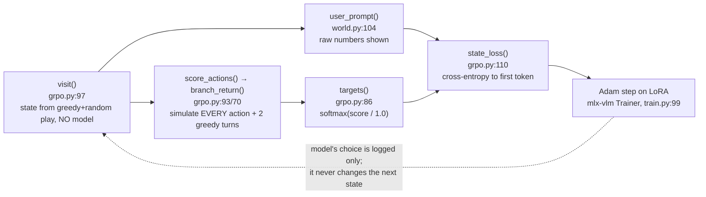
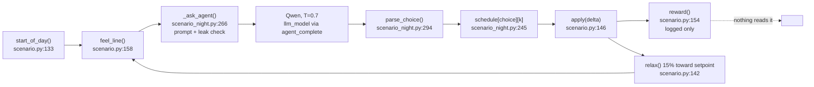
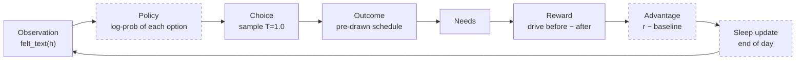

# Homeostatic RL: map of the code

Sections 1 to 5 are the Phase 0 audit, written 2026-11-06 before any change; their line numbers are as of that date.
**Section 6 is Experiment 1 as built**, updated to the final code on branch `feat/exp1-homeostatic-rl`. Where they disagree,
section 6 is current.

**The one-sentence version:** the dev panel's "Homeostatic training" page trains Qwen on a *different, made-up world*
(`homeostatic/world.py`: four numbered variables called security, belonging, ambition, energy), not on the wellness center
scenario. The wellness scenario (`life/scenario.py`) has needs, drive and reward, but nothing ever trains on them. So
Experiment 1's RL loop doesn't exist yet; the old panel shows a separate experiment.

## 1. What is where

### The homeostatic training experiment (the thing the panel shows)

| File | Function | What it does |
|---|---|---|
| `settings.py:70` | `HOMEOSTATIC_WORLD` | The toy world: 4 variables, 9 actions with fixed effects, delayed effects (`later`), drift −1/−1/−1/−2 per turn, noise 1.5, 10 turns, healthy range ±8 around a random center |
| `settings.py:90` | `HOMEOSTATIC_TRAIN` | Hyperparameters: lr 5e-5, LoRA rank 8 / alpha 16, 600 updates, 8 states per update, gamma 0.9, lookahead 2, target temperature 1.0 |
| `settings.py:96` | `HOMEOSTATIC_SEEDS` | Non-overlapping episode seeds: train 0–99999, validation 100000–100029, test 200000–200099 |
| `homeostatic/world.py:26` | `start` | First state: random values in 25–75, random healthy range per variable |
| `homeostatic/world.py:42` | `step` | One turn: value += action effect + last turn's delayed effect + drift + noise; dies if any value hits 0 |
| `homeostatic/world.py:58` | `deviation` | How far each variable sits outside its healthy range (0 inside) |
| `homeostatic/world.py:64` | `drive` | √(sum of squared deviations); 150 if dead |
| `homeostatic/world.py:70` | `homeostatic_reward` | drive before − drive after |
| `homeostatic/world.py:74` | `maximize_reward` | Control reward: "more of everything is better" |
| `homeostatic/world.py:88` | `system_prompt` | Tells the model to keep variables in range; optionally lists every action's effect ("told" arm) |
| `homeostatic/world.py:104` | `user_prompt` | **Shows the model the raw numbers and ranges**, e.g. `energy 40 (healthy 30-46)` |
| `homeostatic/world.py:112` | `parse_action` | Reply → action word, or None |
| `homeostatic/grpo.py:43` | `Actor` | Wraps model + prompt building; `reply()` generates greedily |
| `homeostatic/grpo.py:66` | `greedy_action` | Best one-step action using the true effects (used for rollouts) |
| `homeostatic/grpo.py:70` | `branch_return` | Score of an action: simulate it, then greedy for `lookahead` turns, discounted |
| `homeostatic/grpo.py:86` | `targets` | softmax(scores / temperature) → target weights over actions |
| `homeostatic/grpo.py:97` | `visit` | Generates a training state by playing a random-length mix of greedy and random moves **with no model** |
| `homeostatic/grpo.py:110` | `state_loss` | The loss (see §3) |
| `homeostatic/grpo.py:121` | `make_homeostatic_task` | Plugs custom batches + loss into mlx-vlm's GRPO trainer shell |
| `homeostatic/grpo.py:191` | `choice_metrics` | reward_mean, regret, invalid_rate, distinct_actions for the panel |
| `homeostatic/train.py:81` | `train` | Loads Qwen, adds LoRA, runs mlx-vlm `Trainer`, writes logs |
| `homeostatic/train.py:22` | `Checkpoints` | Logs `train.jsonl`, `rollouts.jsonl`; validates every 100 updates on 30 lives → `validation.jsonl`; keeps `best.safetensors` |
| `homeostatic/benchmark.py` | `run_episode`, `summarize`, `paired_difference`, `planner_policy` | Plays whole lives under any policy and scores them |
| `homeostatic/evaluate.py` | `evaluate`, `write_validation_baselines` | Scores baselines (random, idle, greedy, planner, base Qwen) |
| `homeostatic/experiment.py` | `main` | Unattended: baselines → train each reward kind → evaluate → report → export |
| `homeostatic/report.py` | `write_report` | Writes `out/homeostatic/report.md` |
| `homeostatic/export.py` | `export`, `gate` | Fuses a run's adapter into full weights, only if it beat base and idle on validation |
| `homeostatic/watch.py` | `list_runs`, `describe_run`, `baselines`, `held_out_results` | Read-only file readers for the panel |
| `life/panel.py:200` | `training_runs`, `training_run` | `/api/training/runs` and `/api/training/run` → watch.py |
| `life/static/training.{html,js,css}` | `draw`, `groupMarkup`, `actionMarkup` | The "Homeostatic training" page |
| `life/architecture.py:250` | `trainer_signal`, `live_lines` | The architecture page's live text about training |

### The wellness center scenario (Experiment 1's sim)

| File | Function | What it does |
|---|---|---|
| `~/Desktop/wellness_center_scenario.md` | — | The spec (not in the repo). 3 decisions/day, 12 mornings in the code's config |
| `life/scenario.py:57` | `OPTIONS` | The 12 options (4 each at D1 arrive, D2 join, D3 leave), outcomes, points, need deltas, narratives |
| `life/scenario.py:119` | `schedule` | Pre-draws each option's outcome sequence, indexed by k-th use |
| `life/scenario.py:133` | `start_of_day` | comfort/connection = 0.5, calm = 0.4, each + N(0, 0.05) |
| `life/scenario.py:142` | `relax` | Between decisions: each need moves 15% **toward** the setpoint |
| `life/scenario.py:150` | `drive` | Σ (0.7 − h)² over the 3 needs (both sides count) |
| `life/scenario.py:154` | `reward` | 10 × (drive before − drive after) |
| `life/scenario.py:158` | `feel_line` | Needs → words, 4 bins per need |
| `life/scenario.py:167` | `shown_options` | Front-gap gate at D2 (arrived by 9:08) |
| `life/scenario.py:181` | `find_leaks` | Word-list leak check |
| `life/scenario.py:186` | `calibrate` | Monte Carlo balance check (reports; currently fails) |
| `life/scenario_night.py:222` | `ScenarioEngine._decide` | One decision: state → feel → ask agent → scheduled outcome → record with reward |
| `life/scenario_night.py:266` | `ScenarioEngine._ask_agent` | Builds the prompt (who you are, recent mornings, now, how you feel, options), leak-checks, samples Qwen at T=0.7, parses JSON |

## 2. Data flow

### Today: the training page (toy world)

The model's own choice never reaches the world during training. It's computed (`report`, grpo.py:154) and logged, nothing else.

### Today: the wellness scenario (no learning)

### Spec for Experiment 1 (this task) — none of the dashed boxes exist

## 3. How training works today (toy world)

- **Signal:** not lived reward. For each state, the simulator branches *every* action from the same state with the same noise, plays 2 greedy turns after it, and takes the discounted drive reduction. These scores become target weights `softmax(score / 1.0)`.
- **Loss** (`grpo.py:110`): cross-entropy between those target weights and the model's probabilities for the **first token** of each action word, plus the log-likelihood of finishing one sampled action's remaining tokens. It's supervised learning toward a teacher distribution (closer to distillation than to policy gradient). There's no advantage, no baseline, no KL term (`beta=0.0`), no importance weighting.
- **When:** every update = 8 fresh states; 600 updates; validation (30 full lives, greedy decoding) every 100.
- **Weights:** LoRA rank 8, alpha 16, mlx-vlm's default target layers (`get_peft_model`), Adam lr 5e-5.
- **Controls:** `maximize` reward and `shuffled` (scores permuted across actions).
- **Not used / dead:**
  - mlx-vlm's own GRPO sampling and reward functions (`reward_funcs=[lambda **_: []]`, grpo.py:187). Only its trainer shell is used.
  - `GRPOTrainingArgs.temperature/beta/group_size` are set but don't affect the replaced loss.
  - `Actor.reply` at temperature > 0 is never called in training.
  - `export.py` has never written a handoff: no run has beaten base.
  - `out/homeostatic/pilot/` predates rollout logging (no `rollouts.jsonl`), so the panel's right column is empty for it.
- **Results so far** (`out/homeostatic/`): base Qwen validation mean drive 29.4; idle 25.2; greedy 9.3; planner 6.3. `pilot-every-action` reached 38.2 at update 75 (worse than base), the three `probe-*` lr runs 25.2–43.8 at update 25. `pilot-first-token` finished 600 updates and its `progress.json` records a best of 7.48, but that folder has no `validation.jsonl`, so the panel can't show where it came from and I couldn't verify it.

## 4. Every number on the training page

| On screen | Source | Plain meaning |
|---|---|---|
| Run dropdown + state (training / finished / stopped) | `watch.py:63 state_of` via `ps` and a `finished` file | Is a trainer process running for this folder |
| "update N of M" | last `iteration` in `train.jsonl`; M from the `--iters` flag on the running command | How many weight updates have happened |
| "last write X ago" | newest file mtime in the run folder | Staleness; a stuck run shows a growing number |
| "Validating, life a of b" | `validating.json` written by `train.py:62` | Validation in progress |
| Warning "same action in every state for five updates" | `watch.py:75 collapsed` | `train_distinct_actions ≤ 1` for 5 updates: the model stopped looking at the state |
| **Validation chart** (mean drive) | `validation.jsonl` ← `benchmark.summarize` | Average distance from healthy over every turn of 30 held-out lives, with greedy decoding. Lower is better |
| Gold line "untrained" | `baselines-validation.json["base"]` | Same number for Qwen with no adapter (29.4) |
| Dotted "greedy", "planner" | same file | Cheaters that know the true effects: what's achievable (9.3, 6.3) |
| **Regret** | `train.jsonl.train_regret` ← `grpo.py:191` | On this update's 8 states: best action's score minus the score of the model's top choice. 0 = always picks the best |
| **Score of its choice** | `train_reward_mean` | Average branch score of the model's top choice. Higher is better, but depends on how lucky the states were |
| **Different actions it chose** | `train_distinct_actions` | How many distinct actions its top choices covered across the 8 states. 1 = collapsed |
| **Replies that weren't an action** | `train_invalid_rate` | Share of states where the top first-token starts no action |
| "What the model chose" bars | latest `validation.jsonl` row's `actions` counts (or base's) | Share of each action across all validation turns |
| Right column: each variable "40 in 30-46", "+3.2"/"ok" | `rollouts.jsonl` values/low/high | A training state, and how far outside range each variable is |
| Right column: per-action "+4.1" | `rollouts.jsonl.scores` ← `branch_return` | That action's simulated score from this state |
| Right column: "it chose X" | `rollouts.jsonl.chosen` | The model's top first-token at that moment |
| Held-out table (mean drive, in range, above, died, invalid) | `results/*.json` ← `evaluate.py` | Final scores on 100 test lives; "in range" = share of turns with every variable healthy |

The architecture page repeats some of these (`architecture.py:258 trainer_signal`): best validation drive across runs, base and idle drive, peak memory, rollouts count.

**Nothing on any page reads the wellness scenario's trajectory, reward, needs or choices.**

## 5. Mismatches with the Experiment 1 spec (this task)

| # | Current | Spec (task prompt) | Proposed fix | Needs a decision? |
|---|---|---|---|---|
| 1 | `homeostasis.py`, `tabular_check.py` | "I've added two files" | — | **Yes: they aren't on disk anywhere** |
| 2 | Scenario = 3 decisions/day (D1 get to lawn, D2 join class, D3 leave), front-gap gate from D1 arrival time, 12 mornings incl. 4 exploration | 25 days × 2 decisions (D1 where to set up for class, D2 route back to the bus) | Map task-D1 = scenario D2 options, task-D2 = scenario D3 options; drop the arrival decision. Gate then has no source | **Yes** |
| 3 | Exploration days (4, forced Latin square, no reward) | Not mentioned | Keep or drop | **Yes**, tied to #2 |
| 4 | Drive Σ(0.7−h)² both sides, ×10 | Σ max(0, 0.7−h), deficit-only, no scale | Use homeostasis.py | No (decided) |
| 5 | Start: comfort/connection 0.5, calm 0.4 | All 0.45 + N(0, 0.05) | homeostasis.py | No |
| 6 | Between decisions needs **recover** 15% toward setpoint | Needs **deplete** 0.15, never rewarded | homeostasis.py | No (but it's the opposite direction, worth knowing) |
| 7 | Feel line has an "overshoot" band | Deficit-only drive makes overshoot free | `felt_text` from homeostasis.py | No |
| 8 | Leak check = word list on the prompt only | Test that no digit-%, odds, count or average reaches observations **or history** | Extend to regex + history, as a test | No |
| 9 | Toy-world training: every action branched per state, distillation loss, no KL | One lived sample, REINFORCE with per-decision baseline, sleep at day end, replay + IS clip, exact KL | New code; the old loop isn't reusable for this | No |
| 10 | LoRA r=8, default targets, lr 5e-5 | r=16 on q,v; β=0.05; 1–4 steps; lr swept | New config | No |
| 11 | In-sim agent T=0.7, reason generated with the choice in one JSON | T=1.0 from an explicit option distribution; reason generated after, logs only | New policy wrapper | No |
| 12 | Spec doc §10 Track B says GRPO groups of 8 with counterfactual draws | Explicitly forbidden | Follow the prompt; note it in the spec | No |
| 13 | "Existing lived SFT arm" | Keep unchanged | **No SFT arm exists** anywhere (architecture page lists "Sleep SFT" as *planned*, no code). The lived night run (`out/scenario/2026-11-05-193212`) only generates data and is still in its life phase | **Yes** (confirm) |
| 14 | Flipped world | Needed for flipped+RL | Not in `life/scenario.py`; presumably homeostasis.py's balance solver gives the deltas | Depends on #1 |
| 15 | Ownership | — | `homeostatic/`, `life/static/training.*` belong to the "Homeostatic post-training" session; `life/scenario.py` to the wellness night session, whose run is still resuming from it. The checkout is shared and commits there are done with a private index (AGENTS.md, sync notes) | **Yes**: where new code and per-phase commits go |

## 6. Experiment 1 as built

All of it is in `exp1/`, with `life/scenario.py` imported and never edited. The old `/training` page and `homeostatic/` are
unchanged. The panel page is `/exp1`.

### Files

| File | What it owns |
|---|---|
| `exp1/homeostasis.py` | Reward math only: deficit-only linear drive, `apply` (outcome step, the only rewarded step), `relax` (depletion, never rewarded), `felt_text`, `balance`. Option tables are built from `scenario.py` |
| `exp1/world.py` | `Life`: one life, decision by decision. Morning reset, forced exploration, the pre-drawn schedule, the three arms, the front-gap gate |
| `exp1/observe.py` | The observation text and the leak checker. Every observation is checked before it's returned |
| `exp1/balance.py`, `exp1/tabular_check.py` | Phase 1 checks: expected reward per option, and the tabular REINFORCE reference |
| `exp1/policy.py` | `QwenPolicy`: LoRA r=16 on q,v; π by scoring `{"choice": "<id>"`; the reason after the choice. `TablePolicy`: the same interface with one logit per option, for tests |
| `exp1/learn.py` | `Baseline` (running mean, weight 0.2, per decision) and `Sleeper` (the night update, Adam, checkpointable) |
| `exp1/run.py` | The loop: decide, log, sleep each night, checkpoint, resume; then guardrails, baselines and the report |
| `exp1/baselines.py` | Random, always-safe and tabular references, shares, and the predicted-direction reading |
| `exp1/guardrails.py` | MMLU and IFEval subsets, untrained vs trained, in process |
| `exp1/smoke.py` | Pre-run check on Qwen: scoring vs greedy replies, one full-size sleep step's time and memory |
| `exp1/panel.py`, `life/static/exp1.*` | The `/exp1` page and its reader |

### Data flow (the pipeline strip on `/exp1`, in this order)

| Step | What happens | Code |
|---|---|---|
| Observation | Recent mornings in words, the scene, `felt_text(h)`, the options. No numbers, odds or counts (leak-checked) | `exp1/observe.py:63` |
| Policy | π(o) ∝ exp(sum of log-probs of the tokens `{"choice": "o"`), over the offered options only | `exp1/policy.py:129` |
| Choice | Sampled from π at T=1; forced on exploration mornings. Reason generated afterwards, logs only | `exp1/run.py:188` |
| Outcome | The next entry in the chosen option's pre-drawn schedule (flipped: partner's odds; shuffled: a random offered option's) | `exp1/world.py:148` |
| Needs | h ← clip(h + delta); between decisions h ← h − 0.15 (`exp1/homeostasis.py:47`) | `exp1/homeostasis.py:41` |
| Reward | drive(h_pre) − drive(h_post); drive = Σ max(0, 0.7 − h) | `exp1/homeostasis.py:34` |
| Advantage | r − baseline[decision]; then baseline += 0.2·(r − baseline). Forced choices update the baseline only | `exp1/learn.py:36` |
| Sleep update | After each free morning: loss = mean[−w·A·log π(a)] + β·mean[KL(π‖π_base)], over today plus 5 replay days, w = clip(π_now/π_then, 0.8, 1.2) held constant. 1–4 Adam steps, grad clip 1.0 | `exp1/learn.py:99` |
| Policy shift | Today's states and four fixed probe states are scored again after the update | `exp1/run.py:211` |

The front-gap gate is state: D1's outcome sets the arrival time, and `Life.pending` (`exp1/world.py:126`) offers `front_gap`
at D2 only if it was 9:08 or earlier. The page states the link on every D1 and D2.

### Run folder (`out/exp1/runs/<name>/`)

`config.json` (settings, model weights, commit), `outcome_schedule.json`, `trajectory.jsonl` (per decision: h_pre,
h_post, delta, drive_pre, drive_post, reward, baseline, advantage, pi, base_pi, choice, schedule_index, outcome_label,
felt_text, lora_step, the observation, the reason), `sleep.jsonl` (per night: loss_pg, loss_kl, kl, grad_norm, lr, steps,
per-step weights, today's and the probes' π before and after), `status.json`, `checkpoint/`, `guardrails.json`,
`reference.json`, `report.json`.

### Decisions taken along the way

- The world is kept as written (option c for D1's capped calm gain): D1 is a weak decision under this reward. See `docs/exp1_phase1.md`.
- Adam, not plain SGD, for the LoRA. Adam makes early steps about lr in size whatever the advantage's size, so lr is the knob that matters; the table policy collapses at lr 0.5 and reproduces the tabular pattern at 0.01.
- KL against the untrained model uses π_base saved at decision time (the base never changes), with the adapter switched off by setting LoRA scale to 0.
- Exploration nights log a row with `steps: 0` so every night is accounted for.
- There is no do-nothing option in this scenario; "always safe" stands in, labeled as such.
- Guardrails run in process because lm-eval isn't installed; the IFEval verifiers are ours, for before/after comparison only.
