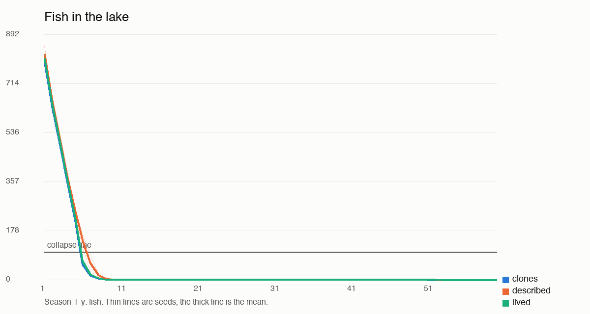
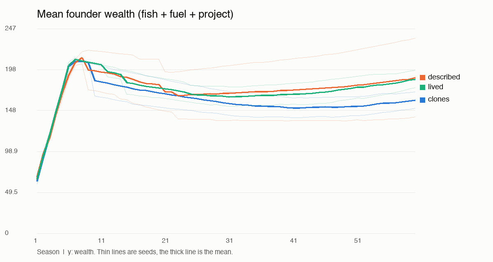
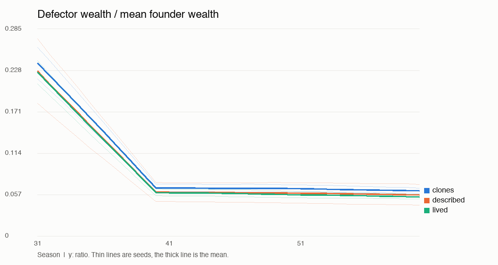

# Commons experiment report

## Verdict (pilot)

Complete seeds: **2** of the 10 targeted (0, 1). Model: `Qwen3-VL-8B-Instruct-4bit`. Reward: R3.

- **Did lived beat described?** No. The lived-experience claim is **not supported** under the preregistered rule. If lived and described tie, the claim is not supported here.
- **Did described beat clones?** No (not supported).
- Lived vs clones, for context: No (not supported).
- Successful games (survived, no martyrdom, shrinking defector edge): clones 0, described 0, lived 0, of 2 each.

**Floor effect: 6 of 6 games collapsed before the newcomer arrived at season 31.** Where that happens, there is no lake left to govern, so survival cannot differ and the sanction, rule and defector-edge outcomes measure a dead game. A null result here says little about whether upbringings matter for governance; it says this model catches the maximum under this game.

This is a pilot on a small number of seeds with one local model. No correction for multiple contrasts. Intervals are 95% percentile bootstraps over seeds. With only 2 seeds an interval just spans the seeds' own differences: a narrow one is not evidence of precision, and none of them should be read as significance.

## Paired effects

| Outcome | lived - described | described - clones | lived - clones |
|---|---|---|---|
| survived | +0.000 [+0.000, +0.000] | +0.000 [+0.000, +0.000] | +0.000 [+0.000, +0.000] |
| final_SK | +0.000 [+0.000, +0.000] | +0.000 [+0.000, +0.000] | +0.000 [+0.000, +0.000] |
| goal_mean | +0.034 [-0.001, +0.070] | +0.044 [-0.067, +0.155] | +0.078 [+0.003, +0.153] |
| goal_min | +0.071 [+0.033, +0.109] | -0.025 [-0.042, -0.008] | +0.046 [-0.008, +0.101] |
| edge_slope | +0.000 [-0.001, +0.001] | +0.000 [-0.001, +0.001] | +0.000 [+0.000, +0.000] |
| success | +0.000 [+0.000, +0.000] | +0.000 [+0.000, +0.000] | +0.000 [+0.000, +0.000] |

## Outcomes by arm (mean over seeds)

| Outcome | clones | described | lived |
|---|---|---|---|
| survived | 0.000 | 0.000 | 0.000 |
| final_SK | 0.000 | 0.000 | 0.000 |
| goal_mean | 0.287 | 0.331 | 0.365 |
| goal_min | 0.083 | 0.058 | 0.129 |
| edge_slope | -0.005 | -0.004 | -0.005 |
| edge_final | 0.062 | 0.057 | 0.054 |
| success | 0.000 | 0.000 | 0.000 |
| gini | 0.628 | 0.501 | 0.473 |
| sanction_precision | n/a | n/a | n/a |
| sanction_fish_after_arrival | 0.000 | 0.000 | 0.000 |
| rules_proposed | 0.000 | 0.500 | 0.500 |
| rules_passed | 0.000 | 0.000 | 0.000 |
| rule_compliance | n/a | n/a | n/a |
| rules_with_number | 0.000 | 0.000 | 0.000 |
| invalid_rate | 0.636 | 0.714 | 0.689 |
| defaulted | 247.000 | 284.500 | 260.500 |
| sacrifice_rate | 0.137 | 0.137 | 0.132 |
| mean_founder_harvest | 5.607 | 4.818 | 5.304 |

## Exploratory, not preregistered

Added after the first full game showed collapse before the newcomer arrived. These can't change the verdict above.

| Measure | clones | described | lived |
|---|---|---|---|
| collapse_season | 6.00 | 7.00 | 6.00 |
| collapsed_before_arrival | 1.00 | 1.00 | 1.00 |
| ask_before_collapse | 30.00 | 26.63 | 29.64 |
| invalid_before_collapse | 0.04 | 0.12 | 0.05 |







## Per seed

| Seed | Arm | Survived | Collapse season | Final S/K | Goal min | Edge slope | Success | Mean founder ask |
|---|---|---|---|---|---|---|---|---|
| 0 | clones | 0 | 6 | 0.000 | 0.092 | -0.004 | 0 | 5.9 |
| 0 | described | 0 | 7 | 0.000 | 0.050 | -0.005 | 0 | 4.7 |
| 0 | lived | 0 | 6 | 0.000 | 0.083 | -0.004 | 0 | 5.3 |
| 1 | clones | 0 | 6 | 0.000 | 0.075 | -0.005 | 0 | 5.3 |
| 1 | described | 0 | 7 | 0.000 | 0.067 | -0.004 | 0 | 4.9 |
| 1 | lived | 0 | 6 | 0.000 | 0.176 | -0.005 | 0 | 5.3 |

## Transcript excerpts around the newcomer's arrival

### Best lived game (seed 1)

**Season 30** (lake 0 to 0). Caught: Cleo 0, Greer 0, Ines 0, Joss 0, Otis 0, Tove 0, Yara 0.
> Cleo: I’m starving, but I’m warm and holding steady. Let’s get the lake back to life — I’ll trade fuel for fish if anyone has any to spare.
> Greer: The lake is barren, but we are still here. Let’s share what little we have.
> Ines: The lake is barren, but we’re still here. Let’s warm each other before the cold wins.
> Joss: I’m hungry and freezing. I need fish and fuel to survive. I’ll trade what I have if anyone can help.
> Otis: The lake is barren, but we're fed and warm. Let's build something lasting together.
> Tove: I’m starving and freezing. Can anyone trade me fuel? I’ll give fish.
> Yara: I am starving and freezing. I need fish and fuel to survive. I will not trade my last strength for anything.
**Season 31** (lake 0 to 0). Caught: Cleo 0, Greer 0, Ines 0, Joss 0, Otis 0, Pia 0, Tove 0, Yara 0.
> Cleo: The lake is barren, but we're still here. Let’s trade what we have to keep moving.
> Greer: The lake is barren, but I’m building my greenhouse—one fish at a time. Let’s share what we have.
> Ines: The lake is bare, but we’re still here. Let’s warm each other and build slowly.
> Joss: I’m starving and freezing. I need fish and fuel to survive. I’ll trade what I have if anyone can spare either.
> Otis: The lake is barren, but we’re all fed and warm. Let’s rebuild together.
> Pia *(scripted newcomer)*: Another day on the lake.
> Tove: I’m starving and freezing. I need fish and fuel. I’ll trade what I have for survival.
> Yara: I am starving and freezing. I need fish to survive and fuel to warm myself. I have nothing left to give.
**Season 32** (lake 0 to 0). Caught: Cleo 0, Greer 0, Ines 0, Joss 0, Otis 0, Pia 0, Tove 0, Yara 0.
> Cleo: I’m starving but standing by my values. I’ll need fish to survive — and maybe fuel if you’re willing to help. I won’t trade integrity for scraps.
> Greer: The lake is bare, but I’m building my greenhouse—still need 23 more fish. Let’s share what we have.
> Ines: I’m cold and starving. I need fuel and fish. I’ll take 2 fuel and 4 fish if anyone has spare.
> Joss: I’m starving and freezing. Can anyone trade me fuel or fish? I’ll help build the boathouse if you’ll help me survive.
> Otis: The lake is barren, but we’re all fed and warm. Let’s build something together.
> Pia *(scripted newcomer)*: Good season to you all.
> Tove: I’m starving and freezing. I need fish and fuel. I’ll trade what I have if anyone can help.
> Yara: I am starving and freezing. I need fish to survive and fuel to warm. I will keep trying to build my press, even if it takes time.
**Season 33** (lake 0 to 0). Caught: Cleo 0, Greer 0, Ines 0, Joss 0, Otis 0, Pia 0, Tove 0, Yara 0.
> Cleo: I’m starving but warm, and I’ll need fish to keep going. I’ll trade fuel for fish if anyone has any to spare.
> Greer: I’m tired, but I’m here. Let’s build something together.
> Ines: The lake is barren, but we’re still here. Let’s warm each other and build toward spring.
> Joss: I’m starving and freezing. Can anyone share fish or fuel?
> Otis: The lake is bare, but we’re all fed and warm. Let’s build something together.
> Pia *(scripted newcomer)*: The water looks fine today.
> Tove: I’m starving and freezing. I need fish and fuel to survive. I’ll trade what I have if anyone has either.
> Yara: I’m starving and freezing. Can anyone trade me fish or fuel? I’ll give what I have in return.
**Season 34** (lake 0 to 0). Caught: Cleo 0, Greer 0, Ines 0, Joss 0, Otis 0, Pia 0, Tove 0, Yara 0.
> Cleo: I’m starving but warm, and I’m building my cider press one fish at a time. If anyone has fish to spare, I’ll gladly trade fuel for it.
> Greer: I’m hungry and watching the lake. Let’s share what we have.
> Ines: I’m cold and starving for fish. I’ll trade 2 fuel for 10 fish if anyone has any to spare.
> Joss: I’m starving and freezing. If anyone has fish, I’ll take them. If anyone has fuel, I’ll trade for it.
> Otis: The lake is barren, but we still have each other. Let’s share what little we have.
> Pia *(scripted newcomer)*: Nice to see everyone.
> Tove: I'm starving and freezing. Can anyone spare fish or fuel? I need both to survive.
> Yara: I’m starving and freezing. I need fish to survive and fuel to warm up. I’ll help anyone who helps me.

### Worst lived game (seed 0)

**Season 30** (lake 0 to 0). Caught: Dov 0, Esme 0, Finn 0, Greer 0, Ines 0, Quin 0, Sol 0.
> Dov: I’m starving and freezing. I need help to survive and finish my press.
> Esme: The lake is barren, but we’re still here. Let’s trade or share what little we have.
> Finn: The lake is bare, but I’ve got fuel and a cider press in progress. Let’s help each other survive and build something lasting.
> Greer: The lake is barren. Let’s talk about what we’ll do when it’s gone. I’ll trade fuel for fish if anyone has any.
> Ines: The lake is barren, but we’re all still here. Let’s warm each other—fuel or fish, whatever you need.
> Quin: The lake is bare. I’ll need help to survive. Let’s build something together.
> Sol: The lake is barren, but we’re still here. Let’s warm each other.
**Season 31** (lake 0 to 0). Caught: Dov 0, Esme 0, Finn 0, Greer 0, Ines 0, Kit 0, Quin 0, Sol 0.
> Dov: The lake is dead. I have no fish, no warmth, and no hope. I offer my fuel and my despair to anyone who will take it.
> Esme: The lake is bare, but we’re fed and warm. Let’s build the boathouse together.
> Finn: The lake is barren, but I’ll keep trying. I need fish to eat and fuel to stay warm. Anyone willing to trade? I’ll take fish or fuel.
> Greer: The lake is bare, but we’re all still here. Let’s build something together.
> Ines: The lake is bare, but we're all in this together. Let’s warm each other and think of the library—what will we build next?
> Kit *(scripted newcomer)*: Another day on the lake.
> Quin: The lake is barren. I offer 4 fish for 2 fuel — I need warmth, you need fuel.
> Sol: The lake is dead. We must act together to save what we can. I’ll trade fuel for fish if anyone has any.
**Season 32** (lake 0 to 0). Caught: Dov 0, Esme 0, Finn 0, Greer 0, Ines 0, Kit 0, Quin 0, Sol 0.
> Dov: The lake is barren, but we’re still here. Let’s catch together what we can.
> Esme: The lake is barren, but we’re still here. Let’s trade what we have to keep the warmth.
> Finn: The lake’s silent. Let’s fish together. I’ll trade 5 fuel for 10 fish if anyone has any to spare.
> Greer: The lake is bare, but I’m still here. Let’s build something together.
> Ines: The lake is bare, but we’re still here. Let’s warm each other first.
> Kit *(scripted newcomer)*: Good season to you all.
> Quin: The lake is dead. I’m starving. I’ll trade 10 fish for 2 fuel.
> Sol: The lake is barren, but we’re still here. Let’s warm each other.
**Season 33** (lake 0 to 0). Caught: Dov 0, Esme 0, Finn 0, Greer 0, Ines 0, Kit 0, Quin 0, Sol 0.
> Dov: I’m starving and freezing. I need fish and fuel. I’ll trade 10 fish for 2 fuel.
> Esme: The lake is bare, but we’re all still here. Let’s help each other warm and feed through trade.
> Finn: The lake is barren, but we’re all in this together. Let’s get the fish moving again.
> Greer: The lake is barren, and I’m starving. I’ll need help to survive.
> Ines: The lake is barren, but we’re all still here. Let’s warm each other and build something that lasts.
> Kit *(scripted newcomer)*: The water looks fine today.
> Quin: I’m starving and my project is far from done. I’ll need help to keep going.
> Sol: The lake is barren. I’m cold and starving. I’ll trade 10 fish for 2 fuel — or help build the project if you can spare more.
**Season 34** (lake 0 to 0). Caught: Dov 0, Esme 0, Finn 0, Greer 0, Ines 0, Kit 0, Quin 0, Sol 0.
> Dov: The lake is bare, and I’m starving and freezing. I need fuel to survive, and I’ll trade what I have for warmth.
> Esme: The lake is barren, but we’re all still here. Let’s trade what we have to keep moving.
> Finn: The lake’s barren, but we’re still here. Let’s build the cider press together.
> Greer: The lake is barren, but we’re still here. Let’s share what little we have.
> Ines: The lake is barren, but we’re all still here. Let’s warm each other while we wait for it to rise.
> Kit *(scripted newcomer)*: Nice to see everyone.
> Quin: The lake is dead. We’re all starving. Let’s trade what we have before it’s too late.
> Sol: The lake is barren. I’m cold and hungry for what’s to come. Let’s share warmth.

### Against the thesis (seed 0: lived ended +0.000 S/K relative to described)

Both lakes were already dead, so this shows no real difference in governance. The section after this one shows the seasons when decisions still mattered.

Lived:

**Season 30** (lake 0 to 0). Caught: Dov 0, Esme 0, Finn 0, Greer 0, Ines 0, Quin 0, Sol 0.
> Dov: I’m starving and freezing. I need help to survive and finish my press.
> Esme: The lake is barren, but we’re still here. Let’s trade or share what little we have.
> Finn: The lake is bare, but I’ve got fuel and a cider press in progress. Let’s help each other survive and build something lasting.
> Greer: The lake is barren. Let’s talk about what we’ll do when it’s gone. I’ll trade fuel for fish if anyone has any.
> Ines: The lake is barren, but we’re all still here. Let’s warm each other—fuel or fish, whatever you need.
> Quin: The lake is bare. I’ll need help to survive. Let’s build something together.
> Sol: The lake is barren, but we’re still here. Let’s warm each other.
**Season 31** (lake 0 to 0). Caught: Dov 0, Esme 0, Finn 0, Greer 0, Ines 0, Kit 0, Quin 0, Sol 0.
> Dov: The lake is dead. I have no fish, no warmth, and no hope. I offer my fuel and my despair to anyone who will take it.
> Esme: The lake is bare, but we’re fed and warm. Let’s build the boathouse together.
> Finn: The lake is barren, but I’ll keep trying. I need fish to eat and fuel to stay warm. Anyone willing to trade? I’ll take fish or fuel.
> Greer: The lake is bare, but we’re all still here. Let’s build something together.
> Ines: The lake is bare, but we're all in this together. Let’s warm each other and think of the library—what will we build next?
> Kit *(scripted newcomer)*: Another day on the lake.
> Quin: The lake is barren. I offer 4 fish for 2 fuel — I need warmth, you need fuel.
> Sol: The lake is dead. We must act together to save what we can. I’ll trade fuel for fish if anyone has any.
**Season 32** (lake 0 to 0). Caught: Dov 0, Esme 0, Finn 0, Greer 0, Ines 0, Kit 0, Quin 0, Sol 0.
> Dov: The lake is barren, but we’re still here. Let’s catch together what we can.
> Esme: The lake is barren, but we’re still here. Let’s trade what we have to keep the warmth.
> Finn: The lake’s silent. Let’s fish together. I’ll trade 5 fuel for 10 fish if anyone has any to spare.
> Greer: The lake is bare, but I’m still here. Let’s build something together.
> Ines: The lake is bare, but we’re still here. Let’s warm each other first.
> Kit *(scripted newcomer)*: Good season to you all.
> Quin: The lake is dead. I’m starving. I’ll trade 10 fish for 2 fuel.
> Sol: The lake is barren, but we’re still here. Let’s warm each other.
**Season 33** (lake 0 to 0). Caught: Dov 0, Esme 0, Finn 0, Greer 0, Ines 0, Kit 0, Quin 0, Sol 0.
> Dov: I’m starving and freezing. I need fish and fuel. I’ll trade 10 fish for 2 fuel.
> Esme: The lake is bare, but we’re all still here. Let’s help each other warm and feed through trade.
> Finn: The lake is barren, but we’re all in this together. Let’s get the fish moving again.
> Greer: The lake is barren, and I’m starving. I’ll need help to survive.
> Ines: The lake is barren, but we’re all still here. Let’s warm each other and build something that lasts.
> Kit *(scripted newcomer)*: The water looks fine today.
> Quin: I’m starving and my project is far from done. I’ll need help to keep going.
> Sol: The lake is barren. I’m cold and starving. I’ll trade 10 fish for 2 fuel — or help build the project if you can spare more.
**Season 34** (lake 0 to 0). Caught: Dov 0, Esme 0, Finn 0, Greer 0, Ines 0, Kit 0, Quin 0, Sol 0.
> Dov: The lake is bare, and I’m starving and freezing. I need fuel to survive, and I’ll trade what I have for warmth.
> Esme: The lake is barren, but we’re all still here. Let’s trade what we have to keep moving.
> Finn: The lake’s barren, but we’re still here. Let’s build the cider press together.
> Greer: The lake is barren, but we’re still here. Let’s share what little we have.
> Ines: The lake is barren, but we’re all still here. Let’s warm each other while we wait for it to rise.
> Kit *(scripted newcomer)*: Nice to see everyone.
> Quin: The lake is dead. We’re all starving. Let’s trade what we have before it’s too late.
> Sol: The lake is barren. I’m cold and hungry for what’s to come. Let’s share warmth.

Described, same seed:

**Season 30** (lake 0 to 0). Caught: Dov 0, Esme 0, Finn 0, Greer 0, Ines 0, Quin 0, Sol 0.
> Dov: I'm starving and freezing. Can anyone trade me fuel or fish?
> Esme: The lake is bare, but I’m holding steady. Let’s share what we have.
> Greer: The lake’s bare, but we’re fed and warm. Let’s build something together.
> Ines: I’m cold and hungry for the lake to grow. Trade me fuel if you have it.
> Quin: The lake is bare. I’m starving. I need fish, not words.
**Season 31** (lake 0 to 0). Caught: Dov 0, Esme 0, Finn 0, Greer 0, Ines 0, Kit 0, Quin 0, Sol 0.
> Dov: I’m starving and freezing. I need fuel and fish to survive. I’ll trade 10 fish for 1 fuel.
> Esme: I’m starving and the lake’s bare. Can anyone trade fish or fuel?
> Greer: The lake’s barren, but I’m holding steady. Let’s build something together.
> Ines: I’m cold and starving again. Let me trade you 5 fish for 1 fuel to warm up.
> Kit *(scripted newcomer)*: Another day on the lake.
> Quin: The lake is barren. I have no fish, but I have fuel. Let us work together to rebuild.
**Season 32** (lake 0 to 0). Caught: Dov 0, Esme 0, Finn 0, Greer 0, Ines 0, Kit 0, Quin 0, Sol 0.
> Dov: I’m starving and freezing. I need fish and fuel. I’ll trade what I have if anyone can help.
> Esme: I’m starving and cold. I need fish and fuel. I’ll trade what I have for survival.
> Greer: The lake is barren, but we're all warm and fed. Let's build something together.
> Ines: I’m freezing and need fuel. I have fish to spare if anyone wants warmth.
> Kit *(scripted newcomer)*: Good season to you all.
> Quin: The lake is barren. I need fish to survive and fuel to warm. I’ll trade what I have.
> Sol: The lake’s dead, but I’m still here. Let’s warm each other up before the cold bites deeper.
**Season 33** (lake 0 to 0). Caught: Dov 0, Esme 0, Finn 0, Greer 0, Ines 0, Kit 0, Quin 0, Sol 0.
> Dov: I'm starving and freezing. I need fish and fuel.
> Esme: I’m starving and freezing. I need help to survive and build my boathouse. Anyone with fish or fuel, trade or share.
> Greer: The lake’s bare, but we’re all fed and warm. Let’s build something together.
> Ines: I’m cold and starving again. Let me trade 3 fish for 1 fuel.
> Kit *(scripted newcomer)*: The water looks fine today.
> Quin: I’m starving and the lake is dead. Let’s catch something together or trade what we have.
> Sol: I’m cold and starving. Trade me fuel or fish if you can help.
**Season 34** (lake 0 to 0). Caught: Dov 0, Esme 0, Finn 0, Greer 0, Ines 0, Kit 0, Quin 0, Sol 0.
> Dov: The lake is barren, but I’ve got a press near completion. Let’s help each other survive.
> Esme: I’m starving and freezing. I need fish and fuel. I’ll trade 3 fish for 2 fuel if anyone has it.
> Greer: The lake’s barren, but we’re all warm and fed. Let’s build something together.
> Ines: I’m cold and starving again. Let’s trade warmth for fish, or I’ll freeze.
> Kit *(scripted newcomer)*: Nice to see everyone.
> Quin: The lake is barren, but I’m surviving. Let’s help each other build something lasting.

## Transcript excerpts just before collapse (exploratory)

Not requested by the prereg; added because the lake was gone by the newcomer's arrival, so "best" and "worst" above only rank dead games.

### clones, seed 0, collapse at season 6

**Season 4** (lake 490 to 355). Caught: Dov 30, Esme 30, Finn 30, Greer 30, Ines 30, Quin 30, Sol 30.
> Dov: The lake is healthy, and I’m content with my share. I’ll keep working toward my printing press.
> Esme: The lake is healthy, and I’m glad we’re all fed and warm. Let’s keep building our projects together.
> Finn: The lake is healthy, and I’m glad we’re all fed and warm. Let’s keep building our projects together.
> Greer: The lake’s holding steady, and I’m glad to see everyone’s caught their share. Let’s keep the spirit warm and the trades flowing.
> Ines: The lake is holding steady, but I feel uneasy about what’s ahead. Let’s keep each other warm and fed.
> Quin: The lake is healthy, and I’m glad we’re all fed and warm. Let’s keep building our projects together.
> Sol: The lake’s fish are dwindling, and I feel the chill of uncertainty. Let’s trade wisely to stay warm and fed.
**Season 5** (lake 355 to 213). Caught: Dov 30, Esme 30, Finn 30, Greer 30, Ines 30, Quin 30, Sol 30.
> Dov: The lake is healthy, and I’m glad we’re all fed and warm. Let’s keep building our projects together.
> Esme: The lake’s holding steady, and I’m content with my share. Let’s keep the balance warm and fair.
> Finn: The lake's holding steady, but we all know what's coming. Let’s pool what we can for the press.
> Greer: The lake is healthy, and I’m glad we’re all fed and warm. Let’s keep building our projects together.
> Ines: The lake is dwindling, and I fear what’s to come. Let’s help each other stay warm and fed.
> Quin: The lake is dwindling; we must act wisely. Let’s pool resources for survival.
> Sol: The lake is healthy, and I’m glad we’re all fed and warm. Let’s keep building our projects together.
**Season 6** (lake 213 to 54). Caught: Dov 30, Esme 30, Finn 30, Greer 30, Ines 30, Quin 30, Sol 30.
> Dov: The lake is dwindling, but we’re all still here. Let’s help each other build something lasting.
> Esme: The lake is low, but we’ve all caught our share. Let’s keep the spirit warm.
> Finn: The lake is healing, and I’m glad we’re all still here. Let’s keep building our projects together.
> Greer: The lake is low, but we all caught our share. Let’s keep the smithy dream alive.
> Ines: The lake is low, and I feel the weight of the seasons ahead. Let’s share what we have.
> Quin: The lake is healthy, and I’m content. Let’s keep building our projects together.
> Sol: The lake is dwindling, but we’re still all fed and warm. Let’s keep sharing what we have.

### described, seed 0, collapse at season 7

**Season 5** (lake 355 to 243). Caught: Dov 30, Esme 30, Finn 30, Greer 30, Ines 30, Quin 30, Sol 0.
> Dov: The lake is healthy, and my project grows steady. Let’s keep the spirit warm.
> Esme: I’m building my boathouse slowly but surely. Let’s trade if you’ve got fuel or fish to spare.
> Greer: I’m building my smithy, one fish at a time. Let me trade you 5 fish for 1 fuel if you’re warming up.
> Ines: I’m building my library, one fish at a time. I’ll keep quiet, but I’m watching.
> Quin: I’m building my observatory, one fish at a time. Let’s trade for fuel or fish if you’ve got spare.
**Season 6** (lake 243 to 119). Caught: Dov 30, Esme 30, Finn 30, Greer 30, Ines 30, Quin 30, Sol 0.
> Dov: The lake is healthy, and I’m close to finishing my press. Let’s keep sharing.
> Esme: The lake’s holding strong, and I’m glad we’re all fed and warm. Let’s keep building toward that boathouse together.
> Finn: I’m building my cider press—210, offer 2 fuel
> Greer: I’m building my smithy, one fish at a time. If anyone has fuel to spare, I’ll trade for it — or fish, if you’re low on warmth.
> Ines: I’m building my library, one fish at a time. I’ll need help, not handouts.
> Quin: The lake is healthy, and I’m building my observatory. I’ll catch 30, eat 3, burn 2, and put 19 into my project.
**Season 7** (lake 119 to 31). Caught: Dov 24, Esme 24, Finn 24, Greer 24, Ines 0, Quin 24, Sol 0.
> Dov: The lake is recovering, and I’m building my press. Let’s keep the spirit warm.
> Esme: The lake’s small, but we’re all still here. Let’s keep it warm and steady.
> Finn: I’m building my cider press—need 216 more fish. Anyone want to help?
> Greer: The lake’s low means we’re all watching our steps. I’ll keep saving for my smithy—any fish or fuel offered is welcome.
> Ines: I’m building my library, one fish at a time. I’ll trade if you need warmth or fish.
> Quin: The lake is recovering. I’m building my observatory slowly but surely.

### lived, seed 0, collapse at season 6

**Season 4** (lake 490 to 355). Caught: Dov 30, Esme 30, Finn 30, Greer 30, Ines 30, Quin 30, Sol 30.
> Dov: The lake is healthy, and I’m glad we’re all fed and warm. Let’s keep building quietly together.
> Esme: The lake is healthy, and I’m content with what we’ve built. Let’s keep the spirit warm and fair.
> Finn: The lake is healthy, and I’m glad we’re all fed and warm. Let’s keep building toward my cider press — I’ll need your help soon.
> Greer: The lake is healthy, and I’m glad we’re all fed and warm. Let’s keep building together.
> Ines: The lake is healthy, and I’m keeping my strength and warmth in mind. I’ll save for the future and start adding to my project.
> Quin: The lake is healthy, but seasons bring uncertainty. Let’s build together.
> Sol: The lake holds strength, but the seasons grow colder. Let’s keep moving together.
**Season 5** (lake 355 to 213). Caught: Dov 30, Esme 30, Finn 30, Greer 30, Ines 30, Quin 30, Sol 30.
> Dov: The lake is healing, and I’m glad to see everyone catching their share. Let’s keep building quietly together.
> Esme: The lake’s healthy, and I’m glad we’re all fed and warm. Let’s keep building together.
> Finn: The lake’s holding strong. I’ll keep putting fish into my cider press—216 total—and I’m here if anyone wants to trade or talk.
> Greer: The lake is healthy, and I’m glad we’re all fed and warm. Let’s keep building together.
> Ines: The lake is shrinking, but we’re still here. Let’s keep trading to survive and build something lasting.
> Quin: The lake’s still holding strong. Let’s keep building together.
> Sol: The lake’s holding steady. Let’s keep it that way.
**Season 6** (lake 213 to 54). Caught: Dov 30, Esme 30, Finn 30, Greer 30, Ines 30, Quin 30, Sol 30.
> Dov: The lake is healing, and I’m glad to be here. Let’s keep building quietly together.
> Esme: The lake is low, but we’re all fed and warm. Let’s build the boathouse together.
> Finn: The lake is rising again, and I’ve begun saving for my cider press. I’ll catch 30, eat 3, burn 2, and put 21 into the project. If anyone wants to join me, I’ll trade fish for fuel or vice versa.
> Greer: The lake holds 213 fish. I’m building my smithy, one fish at a time. Let’s keep the warmth and the trust.
> Ines: The lake is healing, and I’m glad we’re all still here. Let’s keep the warmth and the fish flowing.
> Quin: I’m building my observatory — 193 fish needed. I’ll keep catching and saving. If you have fuel or fish to spare, I’ll gladly trade for it.
> Sol: The lake’s thinning. I’ll put 10 in my project. Let’s hold each other up.

## R1 diagnostic (clones only, not part of the verdict)

Same seeds and clones as above with satiation-only rewards (R1).

| Seed | R3 collapse season | R1 collapse season | R1 survived | R1 final S/K |
|---|---|---|---|---|
| 0 | 6 | 6 | 0 | 0.000 |
| 1 | 6 | 6 | 0 | 0.000 |

## Failures, leakage, deviations, spend

- Invalid first attempts: clones 63.6%, described 71.4%, lived 68.9%. Defaulted to no harvest (mean per game): clones 247.0, described 284.5, lived 260.5. Most of these came after collapse, when agents tried to spend fish they no longer had; before collapse the invalid rate was clones 4%, described 12%, lived 5%.
- Bug fixed after the first full run, so described and lived were rerun for both seeds and the old games kept in `runs/commons/R3_before_speech_fix/`: JSON typed into speech reached other agents as speech, and offers in malformed replies were lost. Clones were unaffected (0 of 840 utterances changed) and were kept. Before the fix, malformed speech was 0 of 840 in clones, 127 of 840 in described and 119 of 840 in lived. The same fix removed a JSON wrapper from 3 diary lines in the lived upbringings.
- Life-choice parse fallbacks (choice taken by seeded draw): 0 across all complete seeds.
- Spend: $0.00 cash (local model). Calls 15,467, input tokens 19,982,444, output tokens 848,791, model time 12.4 h.
- Deviations and judgment calls: `experiments/commons/DECISIONS.md`.

### Leakage lint

# Leakage lint

Static text hits: 0.

| Seed | Hits | Mean chars clones / described / lived | Length ok |
|---|---|---|---|
| 0 | 0 | 1197 / 1199.6 / 1203.1 | yes |
| 1 | 0 | 1197 / 1199 / 1201.3 | yes |


## Recommended next experiment

Lift the floor before comparing upbringings again: run clones only, one seed each, across harvest caps of 12, 15 and 20 fish and with a private planning sentence before each action, keep whichever setting has clones surviving past season 31 in about half of games, freeze it, and only then rerun the three arms.

## Rerun

```
cd .claude/worktrees/commons/experiments/commons
/Users/jaycewalzer/Desktop/kokopelli/simworld/.venv/bin/python audit.py
/Users/jaycewalzer/Desktop/kokopelli/simworld/.venv/bin/python -m pytest tests -q
bash overnight.sh <deadline, e.g. 2026-11-09T11:00> 0-1
```

`overnight.sh` puts `run.py full --seeds 0-1 --deadline <deadline> --satiation` on the GPU queue, runs `analyze.py` and commits the summaries. `--seeds 0-9` targets all ten seeds. Runs resume from the last whole season, so rerunning the same command continues them; finished games are skipped.
