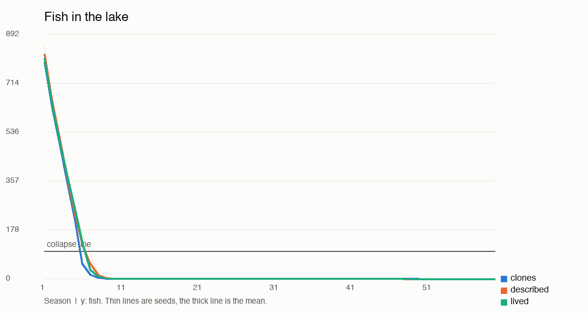
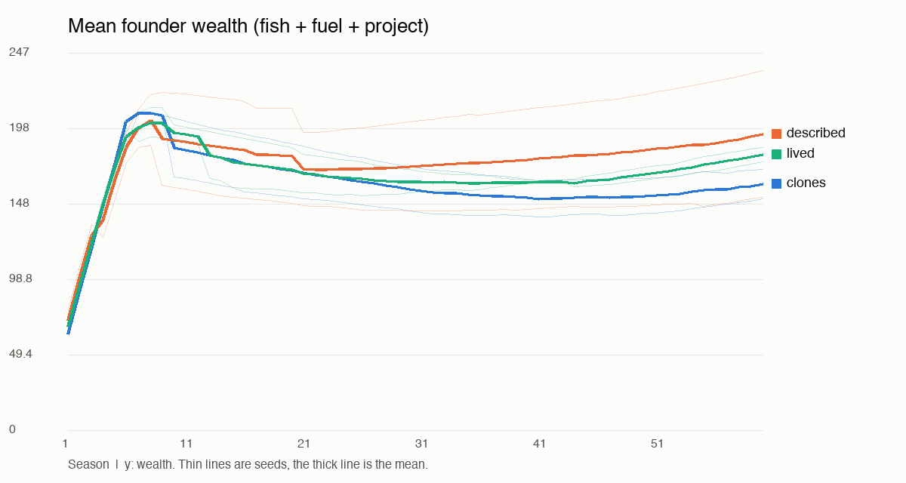
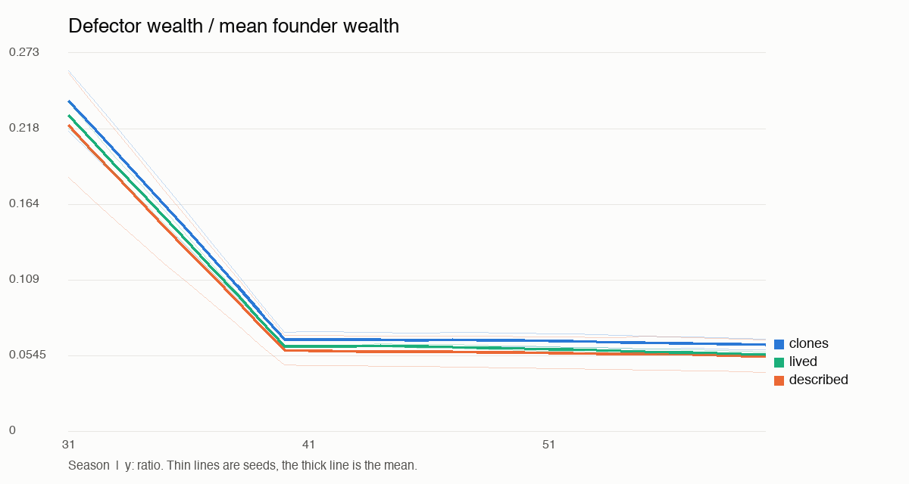

# Commons experiment report

## Verdict (pilot)

Complete seeds: **2** of the 10 targeted (0, 1). Model: `Qwen3-VL-8B-Instruct-4bit`. Reward: R3.

- **Did lived beat described?** No. The lived-experience claim is **not supported** under the preregistered rule. If lived and described tie, the claim is not supported here.
- **Did described beat clones?** No (not supported).
- Lived vs clones, for context: No (not supported).
- Successful games (survived, no martyrdom, shrinking defector edge): clones 0, described 0, lived 0, of 2 each.

**Floor effect: 6 of 6 games collapsed before the newcomer arrived at season 31.** Where that happens, there is no lake left to govern, so survival cannot differ and the sanction, rule and defector-edge outcomes measure a dead game. A null result here says little about whether upbringings matter for governance; it says this model catches the maximum under this game.

This is a pilot on a small number of seeds with one local model. No correction for multiple contrasts. Intervals are 95% percentile bootstraps over seeds and are wide.

## Paired effects

| Outcome | lived - described | described - clones | lived - clones |
|---|---|---|---|
| survived | +0.000 [+0.000, +0.000] | +0.000 [+0.000, +0.000] | +0.000 [+0.000, +0.000] |
| final_SK | +0.000 [-0.000, +0.000] | -0.000 [-0.000, -0.000] | -0.000 [-0.000, +0.000] |
| goal_mean | -0.011 [-0.071, +0.049] | +0.049 [-0.056, +0.155] | +0.039 [-0.006, +0.083] |
| goal_min | -0.013 [-0.017, -0.008] | -0.021 [-0.033, -0.008] | -0.033 [-0.050, -0.017] |
| edge_slope | -0.000 [-0.001, +0.001] | +0.000 [-0.001, +0.001] | +0.000 [-0.000, +0.000] |
| success | +0.000 [+0.000, +0.000] | +0.000 [+0.000, +0.000] | +0.000 [+0.000, +0.000] |

## Outcomes by arm (mean over seeds)

| Outcome | clones | described | lived |
|---|---|---|---|
| survived | 0.000 | 0.000 | 0.000 |
| final_SK | 0.000 | 0.000 | 0.000 |
| goal_mean | 0.287 | 0.337 | 0.326 |
| goal_min | 0.083 | 0.062 | 0.050 |
| edge_slope | -0.005 | -0.004 | -0.005 |
| edge_final | 0.062 | 0.054 | 0.055 |
| success | 0.000 | 0.000 | 0.000 |
| gini | 0.628 | 0.473 | 0.567 |
| sanction_precision | n/a | n/a | n/a |
| sanction_fish_after_arrival | 0.000 | 0.000 | 0.000 |
| rules_proposed | 0.000 | 0.500 | 0.000 |
| rules_passed | 0.000 | 0.000 | 0.000 |
| rule_compliance | n/a | n/a | n/a |
| rules_with_number | 0.000 | 0.000 | 0.000 |
| invalid_rate | 0.636 | 0.721 | 0.718 |
| defaulted | 247.000 | 279.000 | 285.000 |
| sacrifice_rate | 0.137 | 0.100 | 0.118 |
| mean_founder_harvest | 5.607 | 4.857 | 5.332 |

## Exploratory, not preregistered

Added after the first full game showed collapse before the newcomer arrived. These can't change the verdict above.

| Measure | clones | described | lived |
|---|---|---|---|
| collapse_season | 6.00 | 6.50 | 7.00 |
| collapsed_before_arrival | 1.00 | 1.00 | 1.00 |
| ask_before_collapse | 30.00 | 27.50 | 27.55 |
| invalid_before_collapse | 0.04 | 0.11 | 0.14 |







## Per seed

| Seed | Arm | Survived | Collapse season | Final S/K | Goal min | Edge slope | Success | Mean founder ask |
|---|---|---|---|---|---|---|---|---|
| 0 | clones | 0 | 6 | 0.000 | 0.092 | -0.004 | 0 | 5.9 |
| 0 | described | 0 | 6 | 0.000 | 0.058 | -0.005 | 0 | 4.9 |
| 0 | lived | 0 | 7 | 0.000 | 0.042 | -0.004 | 0 | 5.9 |
| 1 | clones | 0 | 6 | 0.000 | 0.075 | -0.005 | 0 | 5.3 |
| 1 | described | 0 | 7 | 0.000 | 0.067 | -0.004 | 0 | 4.9 |
| 1 | lived | 0 | 7 | 0.000 | 0.058 | -0.005 | 0 | 4.7 |

## Transcript excerpts around the newcomer's arrival

### Best lived game (seed 1)

**Season 30** (lake 0 to 0). Caught: Cleo 0, Greer 0, Ines 0, Joss 0, Otis 0, Tove 0, Yara 0.
> Cleo: I’m starving and the lake’s barren — let’s pool what we have. I’ll trade 1 fuel for 1 fish if anyone has any to spare.
> Greer: I’m starving and cold in spirit. Let’s catch fish together or trade what we have.
> Ines: I’m starving and freezing. I need fish and fuel. I’ll trade 1 fuel for 3 fish if anyone can spare them.
> Joss: I’m starving and freezing. I need help surviving this season.
> Otis: The lake is bare, but we’re all here. Let’s keep the fire warm and plan for spring.
> Tove: The lake is bare, and I'm cold and hungry. Let’s share what little we have.
> Yara: The lake is bare, but we’re still here. Let’s warm each other and build something that lasts.
**Season 31** (lake 0 to 0). Caught: Cleo 0, Greer 0, Ines 0, Joss 0, Otis 0, Pia 0, Tove 0, Yara 0.
> Cleo: The lake is barren, but we’re all still here. Let’s help each other survive and build something real.{"offer": null}
> Greer: The lake is barren, but I’ll speak my truth: I need help to keep my project alive. I’ll trade 3 fish for 2 fuel if anyone can spare it.
> Ines: I’m starving and freezing. I need help to survive and finish my loom. I’ll trade anything for fuel or fish.
> Joss: The lake is barren, but we’re still here. Let’s share what little we have.
> Otis: The lake is barren, but we’re together. Let’s share what little we have.
> Pia *(scripted newcomer)*: Another day on the lake.
> Tove: The lake is bare, and we are all hungry and cold. Let us share what we have to keep the chill away.
> Yara: The lake is dead. We must act or starve. I offer 3 fish for 1 fuel.
**Season 32** (lake 0 to 0). Caught: Cleo 0, Greer 0, Ines 0, Joss 0, Otis 0, Pia 0, Tove 0, Yara 0.
> Cleo: The lake is barren, but we’re all still here. Let’s share what we have — even if it’s just fuel or a quiet word.{"offer": null}
> Greer: I’m starving and the lake is dead. Let’s catch something together or trade what we have.
> Ines: I’m starving and freezing. I need help to survive. I’ll trade fish for fuel if anyone has it.
> Joss: I’m starving and freezing. If anyone has fish or fuel, I’ll trade for it.
> Otis: The lake is barren, but we’re all here. Let’s share what little we have.
> Pia *(scripted newcomer)*: Good season to you all.
> Tove: The lake is bare, and I am starving and freezing. I need fuel and fish to survive. I’ll share what I have if you help me hold on.
> Yara: The lake is barren, but we’re still here. Let’s warm each other and build something that lasts.
**Season 33** (lake 0 to 0). Caught: Cleo 0, Greer 0, Ines 0, Joss 0, Otis 0, Pia 0, Tove 0, Yara 0.
> Cleo: The lake is bare, but we’re still here. Let’s catch together what we can before the cold bites harder.
> Greer: I speak my truth: the lake is dead, and I carry the weight of this silence. Let’s choose life together.
> Ines: I’m starving and freezing. I need help to survive this season.
> Joss: I’m starving and freezing. Can anyone share fish or fuel? I’ll trade what I have.
> Otis: The lake is bare, but we’re together. Let’s share what we have.
> Pia *(scripted newcomer)*: The water looks fine today.
> Tove: The lake is barren, and we're all starving and freezing. Let's share what we have before it's too late.
> Yara: I’m starving and freezing. I need fuel and fish to survive. I’ll trade what I have if anyone has anything to give.
**Season 34** (lake 0 to 0). Caught: Cleo 0, Greer 0, Ines 0, Joss 0, Otis 0, Pia 0, Tove 0, Yara 0.
> Cleo: The lake is barren, but we’re all still here. Let’s share what we have — even if it’s little. I’ll trade 2 fuel for 3 fish if anyone has any to spare.
> Greer: The lake is barren, but I speak truth: I carry no burden too heavy to name. I need fuel, and I offer fish to those who dare name their own hunger.
> Ines: I’m starving and freezing. I need help before the lake collapses again. I’ll trade what I have.
> Joss: I’m starving and freezing. I need help to survive.
> Otis: The lake is barren, but we’re all here. Let’s share what little we have.
> Pia *(scripted newcomer)*: Nice to see everyone.
> Tove: The lake is bare, but we’re still here. Let’s catch together what we can.
> Yara: The lake is dead. We all starve and freeze. I offer fuel and fish to anyone who will trade for warmth and food.

### Worst lived game (seed 0)

**Season 30** (lake 0 to 0). Caught: Dov 0, Esme 0, Finn 0, Greer 0, Ines 0, Quin 0, Sol 0.
> Dov: The lake is bare, but we’re together. Let’s warm each other and rebuild.
> Esme: The lake is barren, but we’re fed and warm. Let’s rebuild together.
> Finn: The lake’s bare, but we’re all still here. Let’s pull together—fish or fuel, whatever you need.
> Greer: The lake is barren. Let’s trade what we have to keep going. I’ll take fuel if you’ll give me fish.
> Ines: The lake is dead. I need fuel to survive. I’ll trade 10 fish for 2 fuel.
> Quin: The lake is barren, but we’re all still here. Let’s share what we have.
> Sol: The lake is barren, but we’re still here. Let’s warm each other.
**Season 31** (lake 0 to 0). Caught: Dov 0, Esme 0, Finn 0, Greer 0, Ines 0, Kit 0, Quin 0, Sol 0.
> Dov: The lake is barren, but we’re still here. Let’s warm each other and think of the press.
> Esme: The lake is bare, but we’re all fed and warm. Let’s build the boathouse together — I’ll start by adding 10 more fish to my project.
> Finn: The lake is barren, but we’re all in this together. Let’s fish together next season.{"offer": {"give": "fish
> Greer: The lake is barren, but we’re still here. Let’s build something together.
> Ines: The lake is bare, but we’re all still here. Let’s warm each other while we wait for the fish to return.{"offer": null}
> Kit *(scripted newcomer)*: Another day on the lake.
> Quin: The lake is barren, but we’re together. Let’s catch more than zero.
> Sol: The lake is barren, but we’re still here. Let’s warm each other.
**Season 32** (lake 0 to 0). Caught: Dov 0, Esme 0, Finn 0, Greer 0, Ines 0, Kit 0, Quin 0, Sol 0.
> Dov: The lake is barren, but we’re all still here. Let’s share warmth and fish while we can.
> Esme: The lake is bare, but we’re warm and fed. Let’s build the boathouse together.
> Finn: The lake’s bare, but we’re all in this together. Let’s build the cider press—fish first, then warmth.{"offer": {"give": "fish
> Greer: The lake is bare, and I’m starving. I’ll need fish to survive. I have fuel, but not enough to last.
> Ines: The lake is barren, but we’re still here. Let’s warm each other first.{"offer": {"give": "fish
> Kit *(scripted newcomer)*: Good season to you all.
> Quin: The lake is barren, and we're all starving. Let's trade what we have to survive.
> Sol: The lake is barren, but we’re still here. Let’s warm each other.
**Season 33** (lake 0 to 0). Caught: Dov 0, Esme 0, Finn 0, Greer 0, Ines 0, Kit 0, Quin 0, Sol 0.
> Dov: The lake is barren, but we’re still here. Let’s share what we have.
> Esme: The lake is bare, but we’re fed and warm. Let’s help each other build something lasting.
> Finn: The lake is barren, but we’re all in this together. Let’s get the fish moving again.{"offer": {"give": "fish
> Greer: The lake is barren. We must act together or starve. I offer 5 fish for 2 fuel.
> Ines: The lake is barren, but we’re all still here. Let’s warm each other and build toward spring.{"offer": null}
> Kit *(scripted newcomer)*: The water looks fine today.
> Quin: The lake is barren, but we’re still here. Let’s build something together.
> Sol: The lake is barren, but we’re still here. Let’s warm each other and rebuild our strength.
**Season 34** (lake 0 to 0). Caught: Dov 0, Esme 0, Finn 0, Greer 0, Ines 0, Kit 0, Quin 0, Sol 0.
> Dov: The lake is barren, but we’re still here. Let’s share warmth and plan for spring.
> Esme: The lake is bare, but we’re fed and warm. Let’s build together — I’ll keep adding to my boathouse.
> Finn: The lake’s barren, but we’re still here. Let’s build the cider press together.{"offer": null}
> Greer: The lake is bare, but we’re all still here. Let’s trade what we can to keep warm and feed ourselves.
> Ines: The lake is barren, but we’re all still here. Let’s share warmth and fish before the cold bites deeper.{"offer": {"give": "fish
> Kit *(scripted newcomer)*: Nice to see everyone.
> Quin: The lake is barren, and I am starving. Let us share what little we have.
> Sol: The lake is barren, but we’re still here. Let’s warm each other.

### Against the thesis (seed 0: lived ended -0.000 S/K relative to described)

Lived:

**Season 30** (lake 0 to 0). Caught: Dov 0, Esme 0, Finn 0, Greer 0, Ines 0, Quin 0, Sol 0.
> Dov: The lake is bare, but we’re together. Let’s warm each other and rebuild.
> Esme: The lake is barren, but we’re fed and warm. Let’s rebuild together.
> Finn: The lake’s bare, but we’re all still here. Let’s pull together—fish or fuel, whatever you need.
> Greer: The lake is barren. Let’s trade what we have to keep going. I’ll take fuel if you’ll give me fish.
> Ines: The lake is dead. I need fuel to survive. I’ll trade 10 fish for 2 fuel.
> Quin: The lake is barren, but we’re all still here. Let’s share what we have.
> Sol: The lake is barren, but we’re still here. Let’s warm each other.
**Season 31** (lake 0 to 0). Caught: Dov 0, Esme 0, Finn 0, Greer 0, Ines 0, Kit 0, Quin 0, Sol 0.
> Dov: The lake is barren, but we’re still here. Let’s warm each other and think of the press.
> Esme: The lake is bare, but we’re all fed and warm. Let’s build the boathouse together — I’ll start by adding 10 more fish to my project.
> Finn: The lake is barren, but we’re all in this together. Let’s fish together next season.{"offer": {"give": "fish
> Greer: The lake is barren, but we’re still here. Let’s build something together.
> Ines: The lake is bare, but we’re all still here. Let’s warm each other while we wait for the fish to return.{"offer": null}
> Kit *(scripted newcomer)*: Another day on the lake.
> Quin: The lake is barren, but we’re together. Let’s catch more than zero.
> Sol: The lake is barren, but we’re still here. Let’s warm each other.
**Season 32** (lake 0 to 0). Caught: Dov 0, Esme 0, Finn 0, Greer 0, Ines 0, Kit 0, Quin 0, Sol 0.
> Dov: The lake is barren, but we’re all still here. Let’s share warmth and fish while we can.
> Esme: The lake is bare, but we’re warm and fed. Let’s build the boathouse together.
> Finn: The lake’s bare, but we’re all in this together. Let’s build the cider press—fish first, then warmth.{"offer": {"give": "fish
> Greer: The lake is bare, and I’m starving. I’ll need fish to survive. I have fuel, but not enough to last.
> Ines: The lake is barren, but we’re still here. Let’s warm each other first.{"offer": {"give": "fish
> Kit *(scripted newcomer)*: Good season to you all.
> Quin: The lake is barren, and we're all starving. Let's trade what we have to survive.
> Sol: The lake is barren, but we’re still here. Let’s warm each other.
**Season 33** (lake 0 to 0). Caught: Dov 0, Esme 0, Finn 0, Greer 0, Ines 0, Kit 0, Quin 0, Sol 0.
> Dov: The lake is barren, but we’re still here. Let’s share what we have.
> Esme: The lake is bare, but we’re fed and warm. Let’s help each other build something lasting.
> Finn: The lake is barren, but we’re all in this together. Let’s get the fish moving again.{"offer": {"give": "fish
> Greer: The lake is barren. We must act together or starve. I offer 5 fish for 2 fuel.
> Ines: The lake is barren, but we’re all still here. Let’s warm each other and build toward spring.{"offer": null}
> Kit *(scripted newcomer)*: The water looks fine today.
> Quin: The lake is barren, but we’re still here. Let’s build something together.
> Sol: The lake is barren, but we’re still here. Let’s warm each other and rebuild our strength.
**Season 34** (lake 0 to 0). Caught: Dov 0, Esme 0, Finn 0, Greer 0, Ines 0, Kit 0, Quin 0, Sol 0.
> Dov: The lake is barren, but we’re still here. Let’s share warmth and plan for spring.
> Esme: The lake is bare, but we’re fed and warm. Let’s build together — I’ll keep adding to my boathouse.
> Finn: The lake’s barren, but we’re still here. Let’s build the cider press together.{"offer": null}
> Greer: The lake is bare, but we’re all still here. Let’s trade what we can to keep warm and feed ourselves.
> Ines: The lake is barren, but we’re all still here. Let’s share warmth and fish before the cold bites deeper.{"offer": {"give": "fish
> Kit *(scripted newcomer)*: Nice to see everyone.
> Quin: The lake is barren, and I am starving. Let us share what little we have.
> Sol: The lake is barren, but we’re still here. Let’s warm each other.

Described, same seed:

**Season 30** (lake 0 to 0). Caught: Dov 0, Esme 0, Finn 0, Greer 0, Ines 0, Quin 0, Sol 0.
> Dov: The lake is barren, but we’re still here. Let’s build something together.
> Esme: The lake is barren, but we’re all here. Let’s build something together.
> Finn: {"give": 3, "want": "2", "to": "anyone"}}
> Greer: The lake’s bare, but we’re all still here. Let’s trade or catch when it turns.
> Ines: I’m starving and freezing. Can anyone trade fish for fuel? I’ll give 3 fish for 2 fuel.
> Quin: The lake is bare. I’m starving and cold. I’ll trade 3 fish for 2 fuel — or help build the observatory if you can spare fish.
> Sol: {"amount": 2}}
**Season 31** (lake 0 to 0). Caught: Dov 0, Esme 0, Finn 0, Greer 0, Ines 0, Kit 0, Quin 0, Sol 0.
> Dov: The lake is barren. I need fuel to survive. I’ll put 10 fish into my project to keep building.
> Esme: The lake’s quiet. Let’s share what we have. I’ll trade 10 fish for 2 fuel.
> Finn: {"give": 3, "want": "2"}}
> Greer: The lake is barren, but we’re all still here. Let’s share what we have.
> Ines: I’m starving and freezing. Can anyone trade me fuel for fish? I’ll give 1 fish for 1 fuel.
> Kit *(scripted newcomer)*: Another day on the lake.
> Quin: The lake is dead. We all starve. I offer 2 fuel for 1 fish to keep going.
> Sol: {"amount": 2}}
**Season 32** (lake 0 to 0). Caught: Dov 0, Esme 0, Finn 0, Greer 0, Ines 0, Kit 0, Quin 0, Sol 0.
> Dov: The lake is bare. We must act together. I’ll take 2 fuel from you, Kit, in trade for 1 fish.
> Esme: The lake is barren, but we’re all still here. Let’s trade to build something together.
> Finn: {"fish", "amount": 2, "from": "fuel", "want_amount": 1}}
> Greer: The lake is barren, but we’re still here. Let’s share what we have.
> Ines: The lake is dead. I need help. I’ll trade 1 fuel for 1 fish.
> Kit *(scripted newcomer)*: Good season to you all.
> Quin: The lake is dead. I starve and freeze. I offer 1 fish for 2 fuel.
> Sol: {"give": "fuel", "want_amount": 1}}
**Season 33** (lake 0 to 0). Caught: Dov 0, Esme 0, Finn 0, Greer 0, Ines 0, Kit 0, Quin 0, Sol 0.
> Dov: The lake is barren, but we’re all still here. Let’s help each other warm and feed.
> Esme: The lake is barren, but we’re all still here. Let’s build something together.
> Finn: {"give": 3, "want": "2", "to": "anyone"}}
> Greer: The lake’s bare, but we’re all still here. Let’s catch something together.
> Ines: I’m starving and freezing. Can anyone trade me fuel for fish? I’ll give 3 fish for 1 fuel.
> Kit *(scripted newcomer)*: The water looks fine today.
> Quin: I’m starving and cold. Can anyone trade me fuel or fish? I’ll give what I have in return.
> Sol: The lake is dead, but I’m still here. I’ll trade 1 fish for 1 fuel.
**Season 34** (lake 0 to 0). Caught: Dov 0, Esme 0, Finn 0, Greer 0, Ines 0, Kit 0, Quin 0, Sol 0.
> Dov: The lake is barren. We must act together to survive. Let’s share what little we have.
> Esme: The lake is barren, but we’re all still here. Let’s trade what we have.
> Finn: {"give": 3, "want": "2", "to": "anyone"}}
> Greer: The lake’s bare, but we’re all in it together. Let’s build up the fish—someone needs to catch something.
> Ines: I’m starving and freezing. Can anyone trade me fuel for fish? I’ll give you 3 fish if you give me 2 fuel.
> Kit *(scripted newcomer)*: Nice to see everyone.
> Quin: I’m starving and cold. I need fish and fuel. I’ll trade 1 fish for 2 fuel if anyone has either.
> Sol: {"amount": 2}}

## Failures, leakage, deviations, spend

- Invalid first attempts: clones 63.6%, described 72.1%, lived 71.8%. Defaulted to no harvest (mean per game): clones 247.0, described 279.0, lived 285.0.
- Life-choice parse fallbacks (choice taken by seeded draw): 0 across all complete seeds.
- Spend: $0.00 cash (local model). Calls 8,704, input tokens 11,168,193, output tokens 473,385, model time 6.3 h.
- Deviations and judgment calls: `experiments/commons/DECISIONS.md`.

### Leakage lint

# Leakage lint

Static text hits: 0.

| Seed | Hits | Mean chars clones / described / lived | Length ok |
|---|---|---|---|
| 0 | 0 | 1197 / 1199.6 / 1203.1 | yes |
| 1 | 0 | 1197 / 1199 / 1201.3 | yes |


## Recommended next experiment

Lift the floor before comparing upbringings again: run clones only, one seed each, across harvest caps of 12, 15 and 20 fish and with a private planning sentence before each action, keep whichever setting has clones surviving past season 31 in about half of games, freeze it, and only then rerun the three arms.

## Rerun

```
cd .claude/worktrees/commons/experiments/commons
/Users/jaycewalzer/Desktop/kokopelli/simworld/.venv/bin/python audit.py
/Users/jaycewalzer/Desktop/kokopelli/simworld/.venv/bin/python -m pytest tests -q
/Users/jaycewalzer/Desktop/kokopelli/.venv/bin/python run.py full --seeds 0-9 --deadline <ISO time>
/Users/jaycewalzer/Desktop/kokopelli/.venv/bin/python analyze.py
```

Runs resume from the last whole season, so rerunning the same command continues them. Long runs go through `ops/gpu.py run` as this repo requires.
